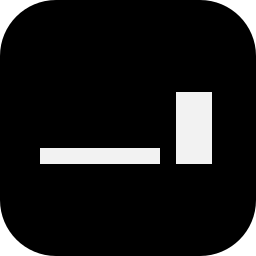
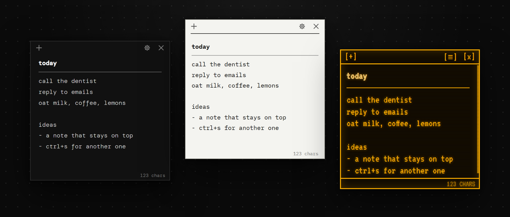

<p align="center">
  
</p>

<h1 align="center">notr</h1>

<p align="center">
  <b>a note. nothing else.</b><br>
  A tiny, always-on-top note app for Windows. No home screen, no menu, no save button.<br>
  You open it and you get a note.
</p>

<p align="center">
  <a href="https://t-julsgaard.github.io/Notr/"><b>Try it in your browser</b></a> ·
  <a href="https://github.com/T-Julsgaard/Notr/releases/latest">Download for Windows</a>
</p>

<p align="center">
  
</p>

## Why

Most note apps want you to organise things: folders, tags, a sidebar, a search box.
notr doesn't. It's a sticky note that stays on top of your other windows and
remembers everything by itself.

- **Always on top.** Notes float above every other program. Among themselves they
  behave like normal windows, so the one you click comes to the front. You can turn
  this off in ⚙.
- **Nothing to save.** Every keystroke is saved. Close notr and it comes back with the
  same notes, in the same places, with the same text.
- **New notes go beside.** `Ctrl+S` or `+` slides a new note in next to the one
  you're in, never on top of another note.
- **Keyboard first.** Resize with `Ctrl` + arrows and move with `Alt` + arrows. Tap
  to nudge, hold to speed up.
- **Seven themes.** ghost, bare mono, paper, dots, gutter, green and amber crt. Font,
  size, bold and italic are remembered per theme.
- **Out of the way.** It starts quietly with Windows and waits in the tray.
  `Ctrl+N` from any program brings your notes back.

## Install

1. Download `notr-setup-1.0.0.exe` from the
   [latest release](https://github.com/T-Julsgaard/Notr/releases/latest).
2. Run it. notr installs for your user only (no admin needed), adds Start menu and
   desktop shortcuts, and opens straight away.

notr isn't code-signed yet, so Windows SmartScreen may say *"Windows protected your
PC"*. Click **More info → Run anyway**. Or build it yourself from source (see below).

To uninstall it, go to **Settings → Apps → notr**.

## Using it

| Do this | To |
|---|---|
| `+` (top left) or `Ctrl+S` | new note, placed beside the current one |
| `×` (top right) or `Ctrl+D` | delete the note; if it has text: `delete note? [y]es [n]o [d]ont show again` |
| `Ctrl+N` (from any program) | bring notr's notes to the front |
| hold `Ctrl` + arrows | resize: → / ↓ grow, ← / ↑ shrink |
| hold `Alt` + arrows | move the note (stops at the screen edge) |
| `/line` then `Enter` (on its own line) | a separator line across the note |
| select text + right click | cut, copy, paste, select all, bold, italic, underline, font, size |
| `⚙` (top right) | theme, font, size, bold/italic, status line, shortcuts |
| drag the title bar / any edge | move / resize the note |
| `Alt+F4` or close from the taskbar | close notr: the notes close, notr waits in the tray, and `Ctrl+N` brings them back exactly as they were |
| tray icon → Quit notr | really quit |

### Settings (⚙)

- **theme**, **font**, **size**, **bold**, **italic**. The font settings are remembered per theme.
- **line / col** and **chars**: the status line at the bottom. chars is on by default.
  In *ghost* the status line only shows on hover.
- **always on top**: on by default. Turn it off and notes go behind whatever program you click.
- **ask before delete**: `[d]ont show again` turns this off; turn it back on here.
- **start with windows**: on by default, so `Ctrl+N` works right after you log in.
- **shortcuts**: writes the shortcut list into the note (see below).

### Changing shortcuts

⚙ → **shortcuts** writes the current list into the note:

```
add note [ctrl+s]
delete note [ctrl+d]
open notr [ctrl+n]
resize note: ctrl + arrows
move note: alt + arrows
separator: /line + enter
```

Edit a key inside the brackets, for example `[ctrl+alt+n]`, and it takes effect a
moment after you stop typing. A shortcut needs `ctrl`, `alt` or `win` plus one key
(a–z, 0–9, F1–F24, arrows, space, home, end, pageup, pagedown, insert, delete).
`open notr` is system-wide, so while notr runs, that key belongs to notr in every
program. Only the bracketed keys can be changed.

### Where your notes live

`%APPDATA%\notr\notr-state.json` holds the notes, positions and settings. A `.bak` of
the previous save sits next to it. Diagnostics go to `%APPDATA%\notr\notr.log`.
Nothing leaves your computer.

## Building from source

You need [Node.js](https://nodejs.org) 20 or newer.

```bash
git clone https://github.com/T-Julsgaard/Notr.git
cd Notr
npm install
npm start
```

If `npm install` skipped Electron's download, run `node node_modules/electron/install.js` once.

Build the Windows installer:

```bash
npm run dist
```

This produces `dist/notr-setup-<version>.exe`.

### Tests

```bash
npm test
```

This runs two end-to-end tests that drive the real app, using a throwaway data folder:

- `scripts/smoke.js` types, formats, opens and deletes notes, switches themes, edits
  shortcuts, resizes and moves with the keyboard, then relaunches to check that
  everything was restored.
- `scripts/scroll-test.js` checks that the view follows the caret in three themes:
  Enter above existing text, inside bold or sized text, around separators, arrow keys,
  Ctrl+Home/End, PageDown and Backspace.

### The website

[The website](https://t-julsgaard.github.io/Notr/) lives in `docs/` and is served by
GitHub Pages. Its try-it demo runs the real note UI: `npm run web` copies `src/note.*`,
`src/themes.css` and the fonts into `docs/app/`. A small bridge (`docs/app/bridge.js`)
and the desk (`docs/desk.js`) stand in for Electron's main process.
`npx electron scripts/screenshots.js` re-renders the theme pictures.

## Project layout

```
src/
  main.js        the main process: windows, placement, saving, tray, shortcuts
  preload.js     the bridge between a note window and main.js
  note.html/js   one note: editor, menus, keys
  note.css       layout shared by every theme
  themes.css     the seven themes
  shortcuts.js   shortcut parsing, shared by main and note
build/           installer script (NSIS)
scripts/         tests, screenshots, website build
docs/            the website and browser demo (GitHub Pages)
simple-notes-design/  the original design mockups the themes came from
```

## License

[MIT](LICENSE)
