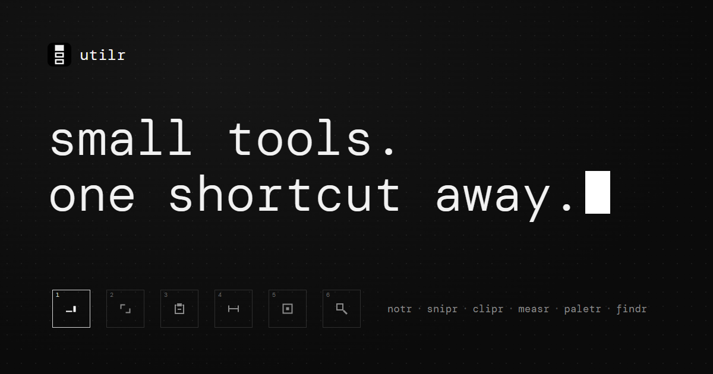

<p align="center"></p>

<h1 align="center">utilr</h1>

<p align="center">
  <b>small tools. one shortcut away.</b><br>
  One quiet launcher for six small desktop tools. One download, one tray icon, every tool.<br>
  Nothing on screen until you ask for it.
</p>

<p align="center">
  <a href="https://t-julsgaard.github.io/Utilr/"><b>See them all (and try them) on the website</b></a> ·
  <a href="https://github.com/T-Julsgaard/Utilr/releases/latest">Download</a>
</p>

<p align="center"></p>

## The tools

Every tool comes with utilr, and every tool is on from the first start.

| | | shortcut | |
|---|---|---|---|
| [**notr**](tools/notr) | tiny notes that stay on top | `ctrl+n` | [page](https://t-julsgaard.github.io/Utilr/notr/) |
| [**snipr**](tools/snipr) | press, drag, it's on your clipboard | `alt+shift+s` | [page](https://t-julsgaard.github.io/Utilr/snipr/) |
| [**clipr**](tools/clipr) | everything you copied today | `alt+shift+v` | [page](https://t-julsgaard.github.io/Utilr/clipr/) |
| [**measr**](tools/measr) | point at it, know its size in px | `alt+shift+m` | [page](https://t-julsgaard.github.io/Utilr/measr/) |
| [**paletr**](tools/paletr) | click any pixel, copy its color | `alt+shift+p` | [page](https://t-julsgaard.github.io/Utilr/paletr/) |
| [**findr**](tools/findr) | every file on every drive, at once (Windows) | `alt+shift+d` | [page](https://t-julsgaard.github.io/Utilr/findr/) |

Each tool's folder has its own README: what it does, every shortcut, and what's special about it.
They all share the ghost look: grey on near-black, DM Mono, chrome only while you hover.

## Install

Get `utilr-setup-<version>.exe` from the [latest release](https://github.com/T-Julsgaard/Utilr/releases/latest)
and run it. It installs for your user (no admin) with all six tools installed and ready, and
opens on the *quick view* page. From then on it lives in the tray and starts with Windows.

utilr isn't signed with a paid certificate yet: if SmartScreen says *"Windows protected your
PC"*, click **More info → Run anyway**. There are macOS (`.dmg`) and Linux (`.AppImage`,
`.deb`) builds too; they're early, and findr and snip text are Windows only.

## Using it

| | |
|---|---|
| `alt+shift+space` | the **quick view**: a narrow column of your pinned tools, from anywhere |
| `alt+shift+u` | open utilr (the launcher) |
| tray icon | click: open utilr. Right-click: every tool's actions, and quit |

All of these shortcuts can be changed on the launcher's *shortcuts* page.

### The quick view

A slim column of square tiles, one per pinned tool, where you need it.

| | |
|---|---|
| `1`–`8` | open that tool |
| `↑` `↓` / `tab` | move |
| `enter` / click | open |
| `esc` / click elsewhere | close |

The last tile (`+`) opens the launcher so you can pin something. Where the column appears
(center, at the pointer, left or right edge) is a setting.

### The launcher

A small ghost window with three pages. At rest it shows the content and nothing else. Hover
for the chrome (title, close, status line).

- **quick view**: which tools are pinned and in what order, with a live preview of the column.
- **shortcuts**: every system-wide shortcut in utilr, both utilr's own and each tool's, in one
  place. Click one and press the new combo. A shortcut belongs to one tool only: utilr says who has it
  (`snipr has it`) and doesn't let two tools fight over a combo.
- **settings**: start with Windows, where the quick view appears, the data folder, versions,
  quit.

`ctrl+tab` moves between pages, `esc` closes the launcher.

### Every tool, ready

Every tool ships with utilr and is installed and running from the first start: each gets its
shortcuts and its actions in the tray (new note, snip in 3 seconds, open folder, …). What you see in
the quick view is up to you: pin, unpin and reorder tools on the launcher's *quick view* page. A
tool that comes with an update is pinned for you while there's room.

On the first start, utilr brings over the data of the stand-alone apps if it finds it
(`%APPDATA%\notr\notr-state.json`, `%APPDATA%\snipr\snipr-settings.json`). Your notes and snipr
settings come along. **Uninstall the stand-alone notr and snipr afterwards**: they would hold the
same shortcuts.

## How it's put together

```
src/            the launcher: tray, quick view, launcher window, shortcuts, tool host
  main.js       app lifecycle, windows, tray, IPC
  host.js       finds tools in tools/, starts and stops them, gives each its own scope
  shortcuts.js  one registry for every system-wide shortcut (one owner each)
  store.js      utilr.json: installed, pinned, shortcuts, settings
  theme/        a copy of the ghost theme kit
tools/
  notr/         notr's own code: windows, preload, theme, fonts, data
  snipr/        snipr's own code, the same way
  clipr/        clipboard history: today's copies, in memory only
  measr/        pixel ruler: edges, boxes, gaps and padding on the frozen screen
  paletr/       color picker: a loupe over the frozen screen, a palette of recent picks
  findr/        file search: every name on every drive, its own index, watched live
ghost-theme/    the ghost theme kit itself: tokens, components, rules (every theme/ is a copy)
docs/           the website (GitHub Pages): a page and a live demo per tool
scripts/        icons.js (app icons), smoke.js (end-to-end test), build-web.js (notr's web demo)
.github/        release workflow: a version tag builds Windows, macOS and Linux
```

Each tool stays in its own folder and doesn't share code with the others. A tool is a
`tool.json` (name, version, description, glyph) plus a `main.js` that exports one function:

```js
module.exports = function mytool(host) {
  // host.ipc        ipcMain, but every channel is "<id>/<channel>" (the preload sends the same)
  // host.shortcuts  globalShortcut, shared fairly between tools
  // host.dataDir    %APPDATA%\utilr\tools\<id>
  // host.changed()  "my shortcuts or actions changed": the launcher refreshes
  return {
    start() {},        // load state, register shortcuts; no windows yet
    stop() {},         // save, close every window, let go of every shortcut
    open() {},         // the main thing: quick view tile, tray, launcher
    actions: () => [{ id, label, key, run }],
    keys: () => [{ id, label, combo, ok }],
    setKey(id, combo) { return { ok: true }; },
  };
};
```

To add a tool, add a folder to `tools/`. The launcher, the quick view, the tray and the shortcuts page
pick it up from there.

notr and snipr started as stand-alone apps in their own repositories (T-Julsgaard/Notr and
T-Julsgaard/Snipr). Their whole histories are merged into this one; only the stand-alone parts
were taken out (tray, start at login, single-instance lock, lifecycle), and each README's
*History* says what changed. `docs/new-tool-prompt.md` is the brief for building the next tool.

Data lives in `%APPDATA%\utilr` (`utilr.json`, `utilr.log`, `tools\<id>\…`).

## Building

```bash
npm install
npm start            # run from source
npm test             # smoke test: drives the real windows, screenshots in smoke-out/
npm run icons        # app icons from assets/logo/svg
npm run dist:win     # installer in dist/ (also dist:mac, dist:linux)
npm run web          # copy notr's note UI into the website's try-it demo
```

### Releasing

Bump `version` in `package.json`, update `.github/release-notes.md`, then push a tag:

```bash
git tag v1.0.0
git push origin v1.0.0
```

`.github/workflows/release.yml` builds Windows, macOS and Linux and publishes the release. The
website's download buttons always point at the newest release.

### The website

[t-julsgaard.github.io/Utilr](https://t-julsgaard.github.io/Utilr/) is `docs/`, served by GitHub
Pages from `main` / `/docs`. Plain HTML, CSS and JS, no build step: `docs/index.html` is the home
page, `docs/<tool>/` a page per tool with a demo you can use in the browser. They run on pretend
screens (measr and paletr read their own canvas pixels, findr searches a made-up drive),
except notr's, which is the real note UI. A new tool gets a page there too.

## Licence

MIT. DM Mono and notr's other fonts are SIL OFL 1.1 (see `src/theme/fonts/OFL.txt`,
`tools/notr/fonts/OFL.txt`).
