# snipr

A quiet screenshot tool for Windows, macOS and Linux. Notr's sibling: same ghost look,
same idea. Nothing on screen until you ask for it.

**Press the key, drag, and the snip is on your clipboard.**



## Using it

| | |
|---|---|
| `alt+shift+s` | snip (from anywhere; change it in settings) |
| `alt+shift+t` | snip text, on Windows: drag, and the text is on your clipboard (no image, no window) |
| drag | select an area. Release takes it |
| click | the whole screen |
| `shift` while dragging | square |
| `space` while dragging | move the selection |
| `enter` | take the selection (or the whole screen) |
| `esc` / right click | cancel |

Opening snipr from the start menu (or starting it a second time) also takes a snip. After that
it waits in the tray: click the tray icon to snip, right-click for *snip text*, *snip in 3 seconds*, the
folder, settings and quit. At login it starts quietly in the tray.

### The snip

When you release the mouse, the snip lifts off the screen right where you took it, in a small
ghost window. At rest it's just the image. Hover for the chrome.

| | |
|---|---|
| `p` `a` `b` `c` `t` `x` | pen, arrow, box, circle, text, blur. Press again (or `v`, `esc`) for the hand |
| text | drag a box: the letters are as tall as the box. A plain click gives normal-sized text. `enter` places it, `shift+enter` adds a line |
| hand + drag the image | drag the snip into a chat, a folder or a document |
| `shift` while drawing | arrows snap to 45°, boxes go square, circles go round |
| `ctrl+c` | copy, with your marks |
| `ctrl+shift+c` | copy the text in the snip (Windows; also the lines button in the bar) |
| `ctrl+s` / `ctrl+shift+s` | save to the folder (again = update that same file) / save as… |
| `ctrl+z` / `ctrl+y` | undo / redo |
| `ctrl+n` | new snip |
| `esc` / `ctrl+w` | close (asks first if you have marks you haven't copied or saved) |
| right click | all of the above as a menu |

**Blur can't be undone.** A normal mosaic keeps an average per block, and those averages are
enough to guess text back. snipr's blur keeps nothing of what's under it except one average
colour for the whole area; each block is that colour shifted by random noise from the system's
secure random source (`crypto.getRandomValues`). A snip goes to the clipboard (and, with auto
save, to the folder) the moment you take it, before you blur; so each blur also replaces that
unblurred original with the blurred version. The clipboard only if it still holds exactly what
snipr put there, so anything you copied since is left alone.

**Copy text** (Windows) reads the snip with the OCR engine built into Windows 10 and 11, the
same one PowerToys' Text Extractor uses. Nothing to install and nothing leaves your machine. It
takes about a third of a second. The text keeps the snip's layout: rows top to bottom, columns
lined up, indentation kept (for code), a blank line between paragraphs, bullets as `- `. It reads
the snip without your arrows, boxes and pen strokes, but with your blurs, so blurred text stays
unreadable; and a blur after you copied the text re-reads it, the same way a blur replaces the
image on the clipboard. It reads the languages Windows has OCR for (Settings → Time & language →
Language, add the language). Like any OCR it can slip on very small text and lone symbols: a
line with only `}` gets dropped, and `l` can come back as `1`.

Marks use the ink set in settings: **ghost** (white with a dark halo, so it reads on anything),
**red** or **black**. Text uses the font set in settings, from notr's font list: JetBrains Mono,
IBM Plex Mono, DM Mono, Martian Mono, Space Mono and VT323 (bundled), plus Cascadia Mono,
Consolas, Segoe UI, Georgia and Arial from the system. The font only changes what you write on
snips; snipr itself stays in DM Mono.

### Settings

Tray → settings, or the gear on any snip.

- auto copy to clipboard: every snip goes straight to the clipboard (on)
- auto open: show the snip window (on). Off gives you just a small `copied` notice
- auto save: also save every snip to the folder (off)
- close after copy: a snip window closes once you copy it (off)
- folder: where snips are saved, `Pictures\snipr` (made when snipr starts), as
  `snip-2026-11-10-142233.png`
- ink, font, snip key, text key (Windows)
- keep snips on top (off), ask before discard (on), start with windows (on)

Settings live in `%APPDATA%\snipr\snipr-settings.json`, with a small log next to it.

## Building

```bash
npm install
npm start            # run from source
npm test             # drives the real windows; screenshots go to smoke-out/
npm run dist:win     # dist/snipr-setup-<version>.exe
```

The logo kit lives in `assets/logo/`; `npm run icons` builds the app icons from it.

## Look

snipr uses notr's **ghost** theme as-is: `src/theme/` is a straight copy of notr's ghost kit
(`ghost.css`, `ghost.js`, DM Mono). The surfaces notr doesn't have (overlay dim, selection,
readouts, toast, annotation inks) are built from those tokens in `src/snipr.css`, under
snipr's own names, so the two apps stay visibly the same family. The selection is marked with
the logo's two crop corners.

## Notes per platform

- **Windows**: tested. The print screen key can be used as the snip key if Windows' own
  "use print screen to open screen capture" is turned off.
- **macOS**: snipr asks for *Screen Recording* permission the first time. Without it,
  captures come back empty.
- **Linux**: works on X11. On Wayland, the desktop's screen-share dialog shows up for each
  capture, which is how Wayland allows screenshots.

## Licence

MIT. The fonts are under the SIL Open Font License 1.1 (`src/theme/fonts/OFL.txt`,
`src/fonts/OFL.txt`).
