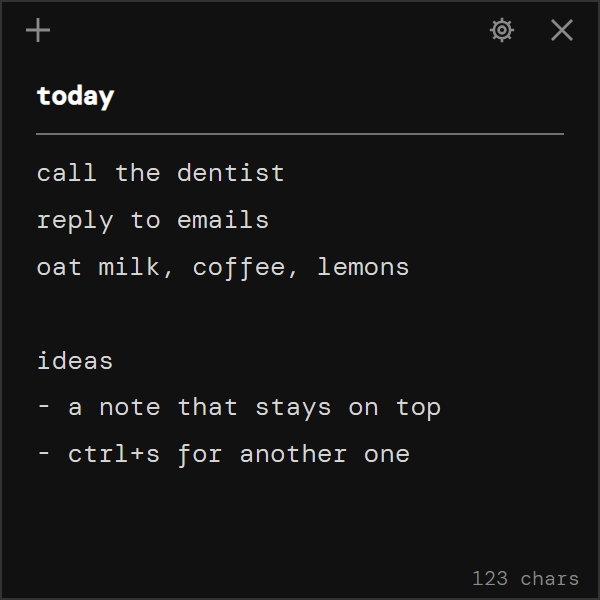

# ghost theme kit

The look of everything in utilr. *ghost* started as notr's default theme (lifted from notr's
`themes.css`, block "05 ghost", and `note.css`) and is packaged here so every tool can inherit it.
`src/theme/` (the launcher) and each tool's `theme/` folder are straight copies of `fonts.css`,
`fonts/`, `ghost.css` and `ghost.js` from this folder; if a copy and this kit disagree, this kit
wins. The website in `docs/` is built from the same tokens.

(Written first for the agent that built snipr, so the notes below still talk about notr and
snipr. They hold for every tool.)

> "the app should feel like a thought, not a program. nothing on screen until you ask for it."
> (from the original ghost design, `reference/05-alt-ghost.html`)



## What's in here

| File | What it is |
|---|---|
| `fonts.css` | `@font-face` rules for DM Mono, pointing at `fonts/` |
| `fonts/` | DM Mono woff2 (300, 400, 500 + 300/400 italic, latin + latin-ext) and its licence (SIL OFL 1.1) |
| `ghost.css` | Tokens (CSS variables) + every component Notr uses: frame, bar, icon button, content, status line, menu, stepper, confirm strip, plus the hover-reveal rule |
| `ghost.js` | ~20 lines: sets `.ghost`, `.hover`, `.focused` on `<body>`; `Ghost.menuOpen(bool)` sets `.menu-open` |
| `tokens.json` | The same values as data (colours, sizes, motion, window settings) |
| `icons/` | The three bar icons (`plus`, `gear`, `close`), stroke-only, `currentColor` |
| `preview.html` | A live ghost window. Open it about 300 × 300 px, move the pointer in and out, click the gear and the ×. `?pin` keeps the chrome visible. |
| `reference/` | Screenshot of Notr in ghost, and the original design mock |

## Using it

```html
<link rel="stylesheet" href="fonts.css">
<link rel="stylesheet" href="ghost.css">
...
<body data-theme="ghost">
  <header class="bar"> ... </header>
  <main class="content"> ... </main>
  <footer class="status"> ... </footer>
  <div class="menu" hidden> ... </div>
  <div class="frame" aria-hidden="true"></div>   <!-- last, draws the 1px border on top -->
  <script src="ghost.js"></script>
</body>
```

Everything is local (no CDN, no Google Fonts), so it works offline and under Notr's CSP:
`default-src 'self'; style-src 'self' 'unsafe-inline'; font-src 'self'; img-src 'self' data:; script-src 'self'`.

Use `preview.html` as the markup reference for each component.

### Electron window

Notr notes are frameless windows whose background matches the theme, so there's no white flash:

```js
new BrowserWindow({
  frame: false,
  backgroundColor: '#111111',   // == --bg
  show: false,
  opacity: 0,                   // faded in on ready-to-show
  // Notr also sets: resizable: true, maximizable: false, fullscreenable: false
});
```

On `ready-to-show`, Notr shows the window and fades opacity 0 → 1 over **220 ms** with ease-out
cubic (`1 - (1 - t)^3`), stepping with `win.setOpacity` every 8 ms. A new note also slides in
over **280 ms**, starting 30 % of the way from the note that spawned it. The `.bar` is the drag
region (`-webkit-app-region: drag`), and its buttons opt out (`no-drag`).

## The rules that make it ghost

1. **Chrome only on hover.** The bar contents, the status line and the window border sit at
   `opacity: 0` and fade in over 250 ms while the pointer is inside the window
   (`body.hover`), and stay up while a menu is open (`body.menu-open`). At rest you see the
   background and the content, nothing else.
2. **No colour.** Everything is grey on near-black. The accent *is* the text colour
   (`#d6d6d6`). The one colour is `--danger` (`#ff7a6b`), for destructive things only.
3. **Hierarchy by grey, not by size or weight.** `#ffffff` strong → `#d6d6d6` text →
   `#8a8a8a` dim/labels/hints. Surfaces step up the same way: `#111111` window →
   `#161616` menu → `#1f1f1f` row hover.
4. **No fills on bar buttons.** Icon buttons go from `#8a8a8a` to `#ffffff` on hover;
   `--hover` is `transparent` on purpose. Only menu rows get a hover fill.
5. **Hardly any lines.** No line under the bar, none over the status. The only borders are the
   1 px window frame (`#2a2a2a`, `#333333` when focused, and only visible on hover), menu
   borders and `#1d1d1d` separators.
6. **Square.** No border radius anywhere. One shadow, on menus only.
7. **One typeface, light.** DM Mono everywhere, weight 300 for text. Content 13 px / 1.8 line
   height, menus 12 px, status and bar labels 10 px.
8. **Quiet motion.** 250 ms opacity fades, 120 ms colour changes, menus drop 4 px in 120 ms,
   the confirm strip rises 6 px in 140 ms. Nothing bounces.
9. **Block caret** in the text colour, selection `rgba(255,255,255,.14)`.

### Words and symbols

Notr's UI text is lowercase and terse, and Snipr should read the same way:

- Labels: `theme`, `always on top`, `ask before delete`, `start with windows`.
- Values sit right-aligned in dim: `on` / `off`, `ctrl+b`, `ghost ›`.
- `>` in the left gutter marks a checked item, `›` opens a submenu, `‹ back` (hint `esc`) leaves one.
- Confirmations are a strip, not a dialog: `delete note?  [y]es  [n]o  [d]ont show again`, with
  the bracketed letter as the key. Enter/`y` confirms, Esc/`n` cancels.
- Status counters: `ln 1, col 1`, `123 chars`.

## Surfaces notr doesn't have

(snipr, measr, paletr, clipr and findr all did this.) Snipr will need surfaces Notr doesn't have: a capture overlay, a selection rectangle, a size
readout, maybe a small annotate toolbar and a "copied" notice. None of these exist in Notr, so
there is no ghost value for them yet. Build them from the tokens above rather than adding new
colours. In ghost terms:

- Floating toolbars and readouts are `--menu-bg` panels with a `--menu-border` edge, square,
  `--menu-shadow`, DM Mono, `--menu-size` or `--status-size`, dim labels.
- Things the user didn't ask for stay invisible or faint until hovered.
- Selection and highlight use white at low alpha (like `--sel`), not a brand colour.
- Red (`--danger`) only for destructive actions such as discarding a capture.
- Copy stays lowercase: `copied`, `saved`, `1280 × 720`.

If Snipr settles on new tokens (overlay dim, selection stroke and so on), add them under their
own names in Snipr. Don't change the values here, so Notr and Snipr stay visibly the same family.

## Fonts

DM Mono © The DM Mono Project Authors, SIL Open Font License 1.1 (`fonts/OFL.txt`). Copied from
`@fontsource/dm-mono` 5.3.0. DM Mono has no bold, so `<b>`/`<strong>` (weight 700) is synthesised
from 500, which is what Notr shows as well.

## What's left out on purpose

Notr's other six themes, the note-specific bits (colour dot, `/line` separator command, keyboard
gliding, tray) and app logic. `ghost.css` renames Notr's `.body` / `.editor` pair to one
`.content` block, and adds a `prefers-reduced-motion` rule. Otherwise the values and component
styles are Notr's, unchanged.
