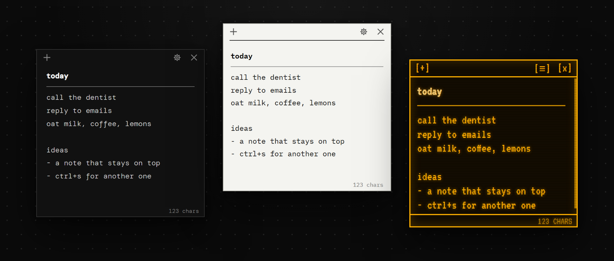

# notr, in utilr

A note, nothing else. Tiny notes that float above every other window and remember everything by
themselves. No home screen, no folders, no save button: press the shortcut and you get a note.

| | |
|---|---|
| `ctrl+n` | open notr: your notes come to the front (from anywhere; change it on utilr's *shortcuts* page or in a note) |
| quick view | open notes |
| tray / launcher | open notes, new note, close notes |

Try it in the browser: [t-julsgaard.github.io/Utilr/notr](https://t-julsgaard.github.io/Utilr/notr/)
(the demo runs this folder's real note UI).



## Why

Most note apps want you to organise things: folders, tags, a sidebar, a search box. notr doesn't.
It's a sticky note that stays on top of your other windows and saves every keystroke.

- **Always on top.** Notes float above every other program. Among themselves they behave like
  normal windows, so the one you click comes to the front. You can turn this off in ⚙.
- **Nothing to save.** Every keystroke is saved. Quit utilr and notr comes back with the same
  notes, in the same places, with the same text. Notes that were open stay open.
- **New notes go beside.** `ctrl+s` or `+` slides a new note in next to the one you're in, never
  on top of another note.
- **Keyboard first.** `tab` jumps between notes. Resize with `ctrl` + arrows and move with `alt` +
  arrows: tap to nudge, hold to speed up.
- **Seven themes.** ghost, bare mono, paper, dots, gutter, green and amber crt. Font, size, bold
  and italic are remembered per theme.

## In a note

| | |
|---|---|
| `+` (top left) or `ctrl+s` | new note, placed beside the current one |
| `×` (top right) or `ctrl+d` | delete the note; if it has text: `delete note? [y]es [n]o [d]ont show again`. A saved note is only closed |
| 💾 (top right, next to ⚙) | save the note: it gets a numbered tab (`1`, `2`, …) next to the `+` in every note. Closing it keeps it, and its tab opens it again. Delete all its text and it's no longer saved |
| `tab` / `shift+tab` | the next / previous note (left to right) |
| hold `ctrl` + arrows | resize: → / ↓ grow, ← / ↑ shrink |
| hold `alt` + arrows | move the note (stops at the screen edge) |
| hold `ctrl` + `f`, then `↑` / `↓` | font size bigger / smaller, for this note only and only while it's open. The size in `⚙` is for every note |
| `/line` then `enter` (on its own line) | a separator line. Copied into other apps it becomes `────────`, and pasting that back makes it a separator again |
| `/draw` then `enter` (on its own line) | a box to draw in, in the theme's text colour. Drag its bottom edge to make it taller; right-click it to undo a stroke, clear it or remove it. It's saved with the note |
| select text + right click | cut, copy, paste, select all, bold, italic, underline, font, size |
| `⚙` (top right) | theme, font, size, bold / italic, status line, always on top, ask before delete, shortcuts |
| drag the title bar / any edge | move / resize |

### Settings (⚙)

- **theme**, **font**, **size**, **bold**, **italic**. The font settings are remembered per theme.
- **line / col** and **chars**: the status line at the bottom (chars is on by default). In
  *ghost* it only shows on hover.
- **always on top**: on by default. Off, notes go behind whatever program you click.
- **ask before delete**: `[d]ont show again` turns this off; turn it back on here.
- **shortcuts**: writes the shortcut list into the note (below).

*Start with windows* isn't here: utilr starts at login and brings notr with it.

### Changing shortcuts

⚙ → **shortcuts** writes the current list into the note:

```
to change a shortcut, just edit it in its [brackets]

── notes
add note [ctrl+s]
delete note [ctrl+d]
open notr [ctrl+n]
switch note: tab
```

Edit a shortcut inside the brackets, for example `[ctrl+alt+n]`, and it takes effect a moment after you
stop typing. A shortcut needs `ctrl`, `alt` or `win` plus one key. `open notr` is system-wide and
also shows on utilr's *shortcuts* page, where it can be changed too; utilr won't let two tools
hold the same shortcut.

## What's special about it

- **One window per note**, frameless, with the theme's background colour so nothing flashes white.
  Notes fade in over 220 ms and a new one slides out of the one that made it.
- **Saving** is a debounced write of one JSON file (`notr-state.json`: notes, positions,
  settings), written to a `.tmp` first with the previous version kept as `.bak`.
- **Placement**: a new note goes to the right of the current one, then left, below, above, and
  only overlaps another note when the screen is full. Notes are kept on screen when displays
  change.
- **Starts in the background.** `start()` reads the state and registers `ctrl+n`; windows are only
  made when you open notr (or for notes that were open when utilr quit).
- **Data:** `%APPDATA%\utilr\tools\notr` (`notr-state.json` and its `.bak`). Nothing leaves your
  computer. The first install copies `%APPDATA%\notr\notr-state.json` over from the stand-alone
  notr if it's there, so your notes come along.
- **Fonts** are bundled in `fonts/` (woff2 only): DM Mono, JetBrains Mono, IBM Plex Mono, Martian
  Mono, Space Mono and VT323, all SIL OFL 1.1.

## Files

```
main.js        the tool: notes as windows, placement, saving, keyboard move / resize, the key
preload.js     a note's bridge, on notr/… channels
note.html/js   one note: editor, menus, confirm strip, tabs, shortcuts
note.css       layout shared by every theme
themes.css     the seven themes
shortcuts.js   shortcut parsing, shared by main.js and the note
fonts/         the bundled fonts and fonts.css
glyph.svg      `_▌`, for the quick view, launcher and tray
assets/        the window icon
```

## History

notr was a stand-alone app (T-Julsgaard/Notr, 1.0.0 to 1.1.1) for Windows, macOS and Linux. Its
whole history is merged into this repository. To make it a utilr tool, `main.js` exports
`notr(host)` instead of starting an app: the tray, app menu, start at login, single-instance lock
and quit handling went to utilr, `ipcMain` / `globalShortcut` became `host.ipc` /
`host.shortcuts`, and the note menu hides *start with windows* (`settings.hosted`).
